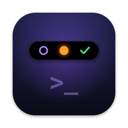
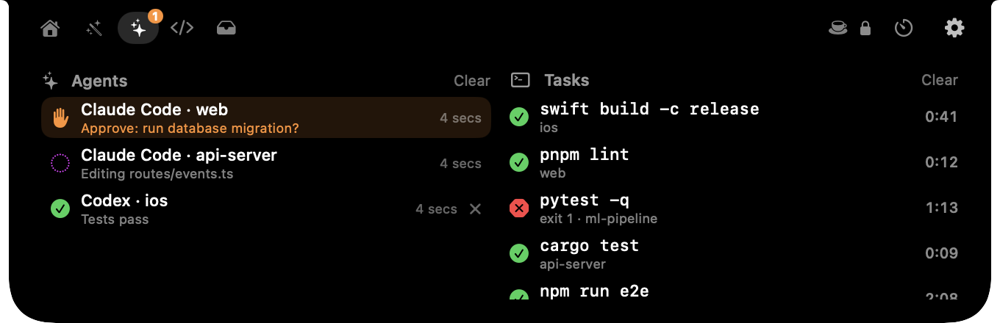
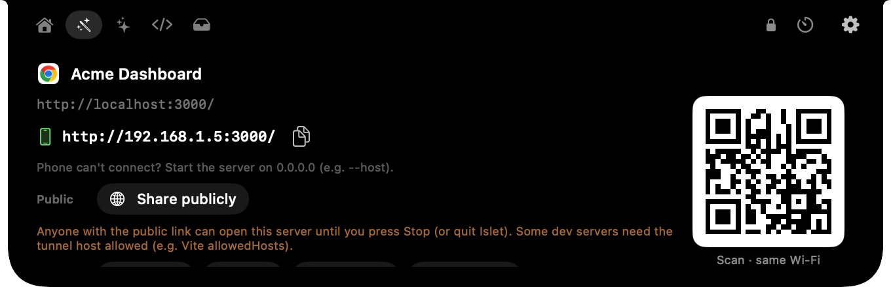
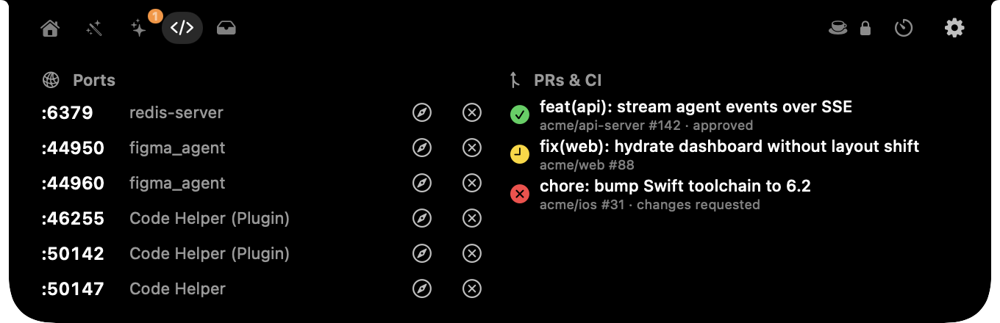
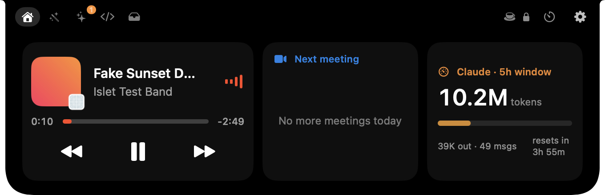

<div align="center">



# Islet

**The notch for developers.**<br>
It watches your background work and adapts to the app you're in.

[**Download for Mac**](https://github.com/YashTygi/islet/releases/latest/download/Islet.dmg) · [Website](https://yashtygi.github.io/islet/) · [Features](FEATURES.md) · [Build from source](#build-from-source)




</div>

---

Every notch app does music, files and a calendar. Islet does those too, but it's built around what developers actually wait on: **AI agents that need approval, builds and tests that take minutes, PRs waiting on CI, and localhost servers you want to show someone.** It's context-aware, so it turns into a git panel in VS Code, a sharing tool in Chrome and a task manager in Terminal.

It's native Swift, about 25 MB of RAM, 0 % CPU when idle, and it never phones home.

## Highlights

|   |   |
|---|---|
| ✋ **Agents that need you** | Claude Code and Codex report *running / needs you / done / error* per project. The notch bounces and chimes when one asks for approval. Click it (or press `J`) to jump to the right terminal. |
| ⏱ **`islet run` anything** | `islet run npm test` shows the task live in the notch, chimes when it ends, and passes the exit code through. Stop or re-run it from the notch. |
| 🪄 **Context-aware App tab** | Actions for the app in front: git and AI commit messages in VS Code, localhost → phone or public link in Chrome, tasks and history in Terminal, paths in Finder, colour picker in Figma. |
| 🧭 **Dev glance** | Listening ports (open / kill), your open GitHub PRs with CI status and review state. |
| 📊 **Claude usage** | Tokens in the current 5-hour window and when it resets, with an optional budget bar. |
| ☕ **Keeps your Mac awake** | While any agent or `islet run` task is running, so long runs don't stall when the display sleeps. |
| 🎛 **And the basics** | Now playing, next meeting with one-click Join, timer and Pomodoro, File Shelf with drag-and-drop and AirDrop, battery and Bluetooth alerts, mic/camera-in-use dots with All Mute. |

## A look inside

<table>
<tr>
<td width="50%"><br><sub><b>App tab in Chrome</b>: a localhost page becomes a phone link + QR, or a public link with one click.</sub></td>
<td width="50%"><br><sub><b>Dev tab</b>: listening ports with open/kill, your PRs with CI and review status.</sub></td>
</tr>
<tr>
<td width="50%"><br><sub><b>Home</b>: now playing, next meeting with Join, Claude usage.</sub></td>
<td width="50%"><br><sub><b>Agents & Tasks</b>: who needs you, what's running, what just finished.</sub></td>
</tr>
</table>

<sub>Screenshots use demo data.</sub>

## It changes with the app you're in

The **App tab** appears only when the app in front has something useful to offer.

| App | What Islet gives you |
|---|---|
| **VS Code / Cursor** | Branch, ahead/behind and changed files. **AI-written commit message** (via your Claude Code CLI; never commits without your click). Stash dashboard, undo last commit, "main ↓N · update" (rebase or merge), a git guide filled in with *your* repo's names, run tests (npm/pnpm/bun/swift/cargo/pytest/go), this project's dev servers. |
| **Chrome / Brave / Safari** | localhost → phone link + QR (same Wi-Fi). **Share publicly** via a Cloudflare or localhost.run tunnel, with QR and a LIVE pill. Window size presets (iPhone/iPad/Laptop/Desktop). Clean links, Markdown links, GitHub repo/PR/issue helpers, Meet and Notion shortcuts. |
| **Terminal / iTerm / Ghostty / Warp** | Live `islet run` tasks with Stop, the last 15 finished tasks (copy, re-run in the same folder), and your last 15 shell commands. Secret-looking lines are hidden. |
| **Finder** | Copy absolute or **git-relative** paths, open Terminal here, images → PDF. |
| **Preview** | Convert, resize and compress images; merge PDFs by dragging them onto the notch; PDF text, pages and passwords. Results land on the Shelf. |
| **Figma** | Screen eyedropper, hex copied, colour history. |
| **Any app** | Your own buttons that run shell commands as tracked tasks. |

## Install

1. **[Download Islet.dmg](https://github.com/YashTygi/islet/releases/latest/download/Islet.dmg)** (about 2.5 MB).
2. Open it and drag **Islet** to **Applications**.
3. Open Islet. macOS will say it can't verify the developer, because Islet isn't notarized yet:
   - Open **System Settings → Privacy & Security**.
   - Scroll down and click **Open Anyway** next to Islet.
   - Confirm. You only do this once.
4. The setup window walks you through the rest:
   - **Accessibility:** for the double-tap-Control shortcut. Islet reads only the Control key.
   - **Calendar** (optional): for the next-meeting card.
   - **Connect Claude Code:** adds Islet hooks to `~/.claude/settings.json` and keeps a backup.
   - **The `islet` command**, so you can type `islet run …` in any terminal.
   - **GitHub** (optional): installs the `gh` CLI and signs you in through your browser. Your token stays in your Keychain.
   - **Open at login.**

Requirements: a Mac with **Apple silicon** (M1 or later) running **macOS 14 Sonoma or later**. Screens without a notch get a slim pill at the top.

<details>
<summary><b>Uninstall</b></summary>

1. Control panel → Agents → **Remove** the Claude Code hooks.
2. Quit Islet and drag it from Applications to the Trash.
3. Optional cleanup: `~/Library/Application Support/Islet`, and the `islet` link in `~/.local/bin` (or `/opt/homebrew/bin`).

</details>

## Using it

**Open it:** hover the notch, or **double-tap Control** to open it locked with keyboard focus.

| Shortcut | Action |
|---|---|
| `⌃` `⌃` | Open / close (works anywhere) |
| `⌘1` … `⌘6`, `←` `→` | Switch tabs |
| `J` | Jump to the agent that needs you |
| `M` | Mute / unmute the mic in all apps |
| `Space`, `⌘←` `⌘→` | Play / pause, previous / next track |
| `⌘T` | Timer: `1`–`6` presets, `F` focus (Pomodoro), `X` cancel |
| `⌘,` | Control panel |
| `⌘/` or `?` | Show all shortcuts |
| `Esc` | Close |

These work while the notch is open, whether it's locked or you're hovering over it.

### Watch any long task

```bash
islet run npm test
islet run swift build -c release
islet run ./deploy.sh staging
```

Output stays in your terminal and the exit code is passed through, so it works in scripts. The notch shows elapsed time, then ✓ or ✗ with a chime.

### Agents

**Claude Code** connects in one click during setup (or Control panel → Agents). **Codex**: set Islet as its `notify` program (the snippet is in Control panel → Agents). **Anything else** can report in with one line:

```bash
islet agent running --name "My Agent" --project api-server
islet agent waiting --name "My Agent" --project api-server --message "Approve deploy?"
islet agent done    --name "My Agent" --project api-server
```

### The CLI

```
islet run <command…>          run and watch a command
islet agent <state> [opts]    running | waiting | done | error | ended
islet hook claude             Claude Code hook (installed for you)
islet hook codex <json>       Codex notify program
islet usage                   current Claude 5-hour window as JSON
islet media <op> …            image/PDF tools used by the Preview panel
islet settings                open the control panel
```

## Light by design

Islet was built after watching a popular notch app grow to gigabytes of RAM, so staying light is the first requirement, not an afterthought.

| | Islet |
|---|---|
| Memory, normal use | ~23–29 MB |
| Memory, peak under a synthetic stress test | ≤ 35 MB |
| CPU when idle | 0 % |
| Background disk writes | none |
| Download | ~2.5 MB |

How:
- **Heavy work in short-lived helpers:** log scanning, image/PDF processing, QR codes and AppleScript all run in separate processes that exit when done.
- **Event-driven:** nothing polls while hidden.
- **No continuous animations:** the open notch is torn down when it closes.

A repeatable load test lives in [`tools/loadtest.sh`](tools/loadtest.sh). The Camera tab (opt-in) uses CPU only while it's open, like any camera app.

## Privacy

- **No account, no login, no analytics, no server.** Everything runs on your Mac.
- Optional integrations use **your own** `claude` and `gh` CLIs and their own sign-in. Islet never sees your tokens.
- The keyboard shortcut reads only the Control key. Shell history lines that look like secrets are hidden.
- A public tunnel runs only when you click **Share publicly**, shows a LIVE pill the whole time, and stops on Stop or quit.

## Build from source

Needs Apple silicon, macOS 14+, and Xcode or the Command Line Tools (Swift 6).

```bash
git clone https://github.com/YashTygi/islet.git
cd islet
./build.sh run          # builds build/Islet.app and launches it
./tools/make-dmg.sh     # builds dist/Islet-<version>.dmg
```

`build.sh` signs with a local certificate named "MyNotch Dev" if you have one (so macOS permissions survive rebuilds), and falls back to ad-hoc signing otherwise.

**Project layout**
```
Sources/Islet/        the app (SwiftUI + AppKit, one non-activating panel per screen)
Sources/IsletCLI/     the `islet` command and the helper for heavy work
Vendor/               mediaremote-adapter (BSD-3) for Now Playing on macOS 15.4+
tools/                DMG, icon, load test, fake media player
```

Dev switches: `ISLET_DEBUG=1` (logging), `ISLET_SELFTEST=1`, `ISLET_ONBOARDING=1`, `ISLET_TEST_*` hooks. See [FEATURES.md](FEATURES.md) for every feature in detail.

## Roadmap

- Native hooks for more agents (Cursor, Gemini CLI)
- Usage meters for more providers
- Xcode build status in the App tab
- Notarized builds (no "Open Anyway" step)
- URL scheme / webhook to push your own live activities

Ideas and PRs are welcome: [open an issue](https://github.com/YashTygi/islet/issues).

## Credits

- [mediaremote-adapter](https://github.com/ungive/mediaremote-adapter) by ungive (BSD-3-Clause): Now Playing support.
- Built with Swift, SwiftUI and AppKit. No other dependencies.

## License

[MIT](LICENSE) © 2026 Yash Tyagi
